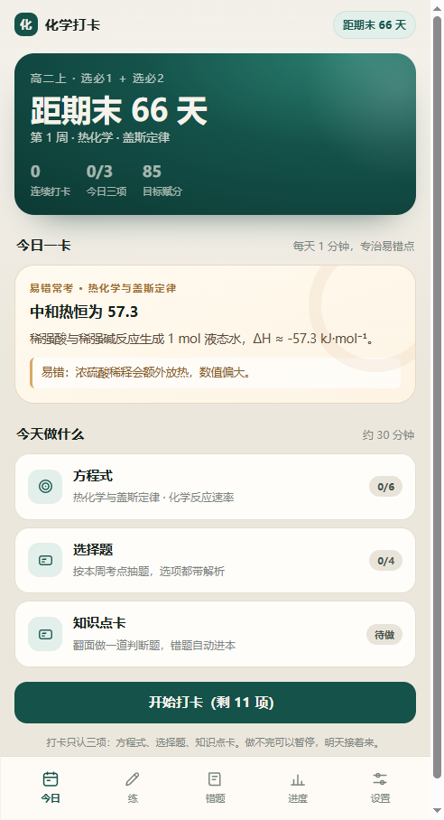
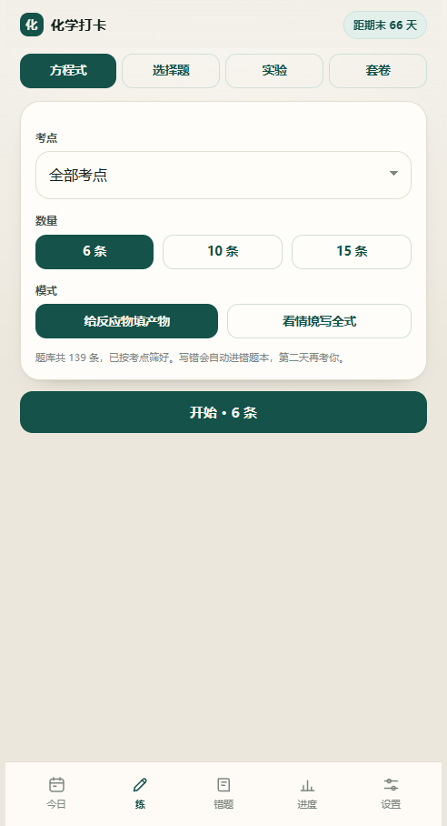
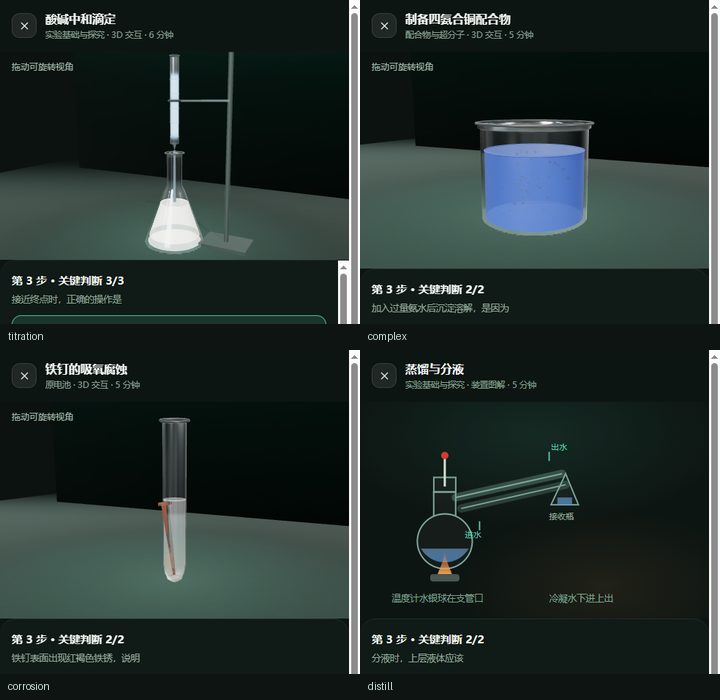

# 化学打卡

高二化学选考 · 期末冲 85 赋分的每日打卡网页应用。手机优先、纯前端、数据只存在本机。

**在线地址：<https://ljjjc123.github.io/chem-daka/>**（GitHub Pages，手机直接打开）
仓库：<https://github.com/LJJJC123/chem-daka>

- 每天 25 分钟：6 条方程式 + 4 道选择题 + 1 张易错卡
- 方程式支持"给反应物填产物"和"看情境写全式"两种模式，自动判配平
- 13 个 3D 交互实验 + 1 个装置图解：选仪器 → 排步骤 → 关键判断 → 现象记录 → 总结
- 错题自动进本，第二天优先重考
- 进度页：原始分 → 赋分估算、四道坎、考点掌握、AI 周报

规格与设计取舍见 [SPEC.md](./SPEC.md)，学习安排见 [8周计划.md](./8周计划.md)。

<p>
  
  
  
</p>

---

## 快速开始

需要 Node 18+（本机已装 pnpm）。在本目录执行：

```powershell
pnpm install      # 只需一次
pnpm dev          # 打开 http://localhost:5180
```

手机上用：确保手机和电脑在同一个 WiFi，电脑执行 `ipconfig` 找到局域网 IP（形如 192.168.1.x），手机浏览器打开 `http://192.168.1.x:5180`。

> 手机访问时电脑要保持 `pnpm dev` 运行；数据存在那台手机自己的浏览器里，换设备请先在「设置 → 导出备份」。

生产构建：

```powershell
pnpm build        # 产物在 dist/，可直接上传任意静态托管
pnpm build:single # 单文件版 dist-single/index.html（约 960KB，发手机就能打开）
pnpm serve:dist   # 本地模拟"部署到子目录"，检查相对路径
```

部署（含国内平台方案与网络说明）见 [DEPLOY.md](./DEPLOY.md)。

---

## 每天怎么用

0. 第一次打开先去「设置」：把**开始打卡日期**选成今天/明天/后天，期末日期改成学校的实际日期
1. 打开「今日」，先看那张易错卡（1 分钟）
2. 点「开始打卡」，按顺序做：方程式 → 选择题 → 卡片
3. 卡住可以「看答案」，但会计入错题
4. 做完看结算；错的考点第二天会自动再出现
5. 周日去「进度」生成一份周报，看下周主攻什么

打卡只认三项：方程式、选择题、卡片。做不完随时退出，第二天接着来。

---

## 接 AI（可选）

不配 AI 也能用全部题库、错题、实验室和规则版周报，只是不能"现出题"和"AI 写周报"。

### 方式一：本地代理（推荐，Key 不进浏览器）

在 `chem-daka/` 下新建 `.env.local`：

```
CHEMQ_API_KEY=sk-你的key
CHEMQ_BASE_URL=https://api.deepseek.com/v1
CHEMQ_MODEL=deepseek-chat
```

然后另开一个终端：

```powershell
pnpm api          # 启动代理，监听 127.0.0.1:5181
```

应用里「设置 → 调用方式」保持「本地代理」，点「测试连接」。

### 方式二：直连

「设置 → 调用方式 → 直连」，填 API Key。Key 存在这台设备的 localStorage，别在公用电脑上填。

支持 DeepSeek / OpenAI / 通义千问 / 自定义 OpenAI 兼容接口。

---

## 命令

| 命令 | 作用 |
|---|---|
| `pnpm dev` | 开发服务器（端口 5180，可用手机访问） |
| `pnpm build` | 生产构建 |
| `pnpm preview` | 预览构建产物 |
| `pnpm api` | 启动 AI 本地代理（端口 5181） |
| `pnpm check:content` | 方程式配平 + 题库结构 + 实验数据自检 |
| `pnpm test` | 解析 / 判分 / 赋分 / 抽题 单元测试 |

每次改完内容建议跑一遍 `pnpm check:content`，配平错了会被直接拦下。

---

## 目录

```
chem-daka/
├─ src/
│  ├─ App.jsx                # 壳：顶部栏、五个页签、会话与实验室浮层
│  ├─ pages/                 # 今日 / 练 / 错题 / 进度 / 设置 / 实验室
│  ├─ components/            # 会话流程、图标
│  ├─ lab3d/scene.js         # three.js 实验台（程序化玻璃器皿）
│  ├─ lib/                   # 化学解析、判分、赋分、抽题、存储、AI
│  ├─ data/                  # 方程式、选择题、卡片、实验、考点
│  └─ styles.css             # 设计 token 与全部样式
├─ server/proxy.mjs          # 本地 AI 代理
├─ scripts/                  # 内容自检
├─ tests/                    # node:test 单测
└─ SPEC.md / 8周计划.md
```

---

## 常见问题

**打不开页面？** 先确认 `pnpm dev` 还在运行；端口被占时会自动换端口，看终端输出的地址。

**3D 实验卡？** 弱机型会自动降级，画面不出时仍可完成流程；想更轻量就选「装置图解」的蒸馏实验。

**数据会丢吗？** 存在浏览器 localStorage。清浏览器数据、换设备、无痕模式都会丢，定期「导出备份」。

**题目有错？** 这是自编题库，以教材和老师为准。发现错误直接改对应 `src/data/*.js`，然后跑 `pnpm check:content`。

**手机很卡？** 主包只有 ~122KB（gzip），3D 是单独懒加载的。若仍卡，优先用步骤卡实验。
